# 💰 Controle Financeiro

Fluxo de caixa diário com **projeção de saldo**: em vez de fechar o mês e olhar para trás, o app mostra qual será o seu saldo em cada dia dos próximos meses — inclusive o dia em que ele fica negativo.

🔗 **[controle-financeiro-lime-gamma.vercel.app](https://controle-financeiro-lime-gamma.vercel.app/)**

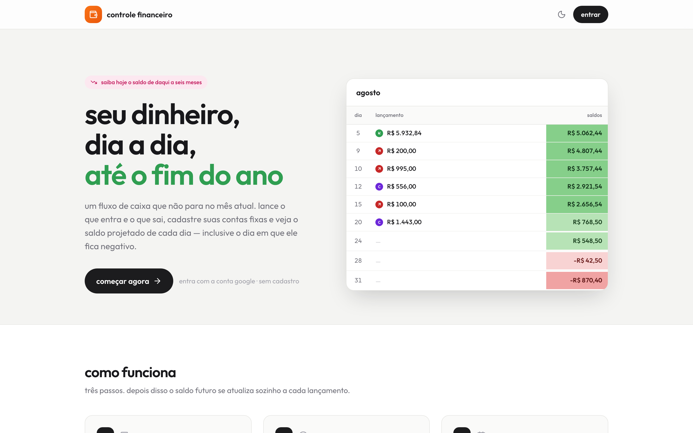

---

## 👤 Guia do Usuário

### A ideia central: saldo projetado

O app trabalha com dois tipos de informação:

| | O que é | Efeito no saldo |
|---|---|---|
| **Lançamentos** | O que de fato aconteceu ou está agendado: salário, aluguel, uma compra | Entra no saldo no dia exato |
| **Orçamentos fixos** | Quanto você costuma gastar por categoria no mês | Vira uma **cota diária** que é reservada do saldo, de hoje em diante |
| **Cartões** | O dia em que a fatura vence | Junta as compras do cartão e cobra tudo de uma vez no vencimento |

Um orçamento de `R$ 1.200` dividido por `30` reserva `R$ 40` por dia. É isso que faz a projeção parar de ser otimista: o saldo de dezembro já desconta o mercado de todos os dias até lá.

No passado essa cota **não** é aplicada — lá vale o que você realmente lançou.

### As quatro telas

#### 📊 saldos

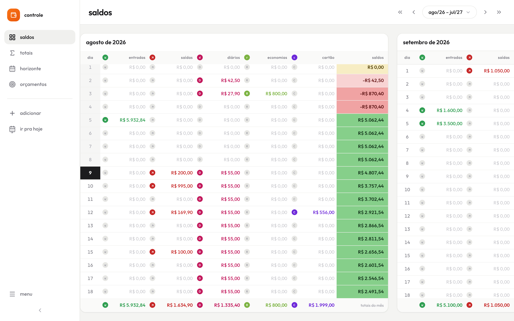

Um bloco por mês, lado a lado (role na horizontal). Cada linha é um dia, com uma coluna para cada tipo de lançamento e a coluna **saldos** colorida pela faixa do valor — do verde escuro (folgado) ao vermelho (negativo). O rodapé soma cada coluna no mês.

O dia de hoje aparece destacado em preto. Clique em qualquer linha para abrir os lançamentos daquele dia.

#### 📅 horizonte

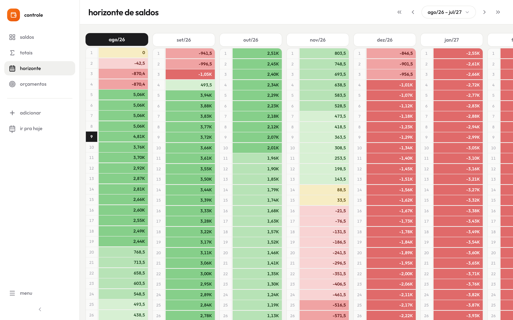

Vários meses em colunas estreitas, só dia e saldo. É a visão para responder "quando é que isso aperta?" — a virada de verde para vermelho salta aos olhos.

#### Σ totais

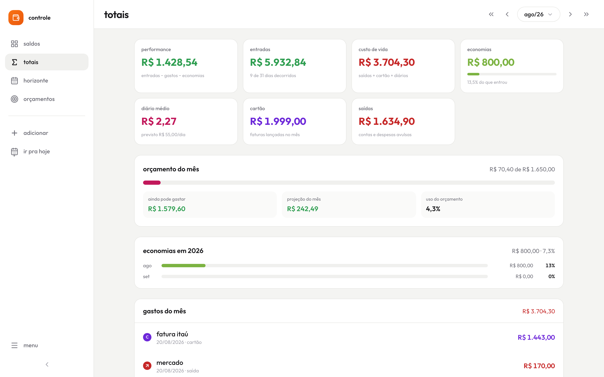

Fechamento do mês escolhido: performance (entradas − gastos − economias), custo de vida, quanto do orçamento já foi usado, projeção de fechamento no ritmo atual, evolução das economias no ano e a lista de todos os gastos.

#### 🎯 orçamentos e cartões

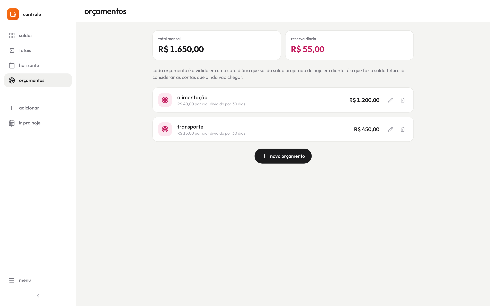

Cadastro das contas recorrentes que alimentam a cota diária. O card do topo mostra o total mensal e quanto isso representa por dia.

Na mesma tela ficam os **cartões**: nome e dia do vencimento. Um gasto lançado como cartão não sai do saldo no dia da compra — ele espera o primeiro vencimento igual ou posterior a ela, então uma compra do dia 20 num cartão que vence dia 10 só pesa no saldo no dia 10 do mês seguinte, junto com o resto da fatura.

### Lançando algo

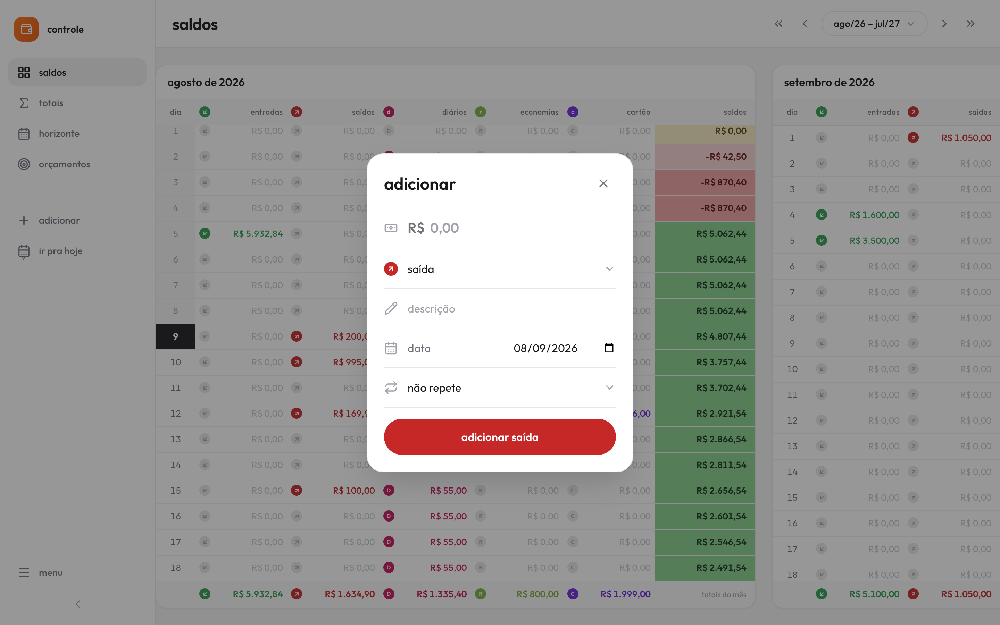

Pelo botão **adicionar** na barra lateral (ou o **+** verde no celular), ou clicando direto no dia na tabela — nesse caso a data já vem preenchida.

Os cinco tipos:

| Tipo | Para quê |
|---|---|
| 🟢 **entrada** | Salário, comissão, qualquer dinheiro que chega |
| 🔴 **saída** | Contas e despesas avulsas |
| 🩷 **gasto diário** | O dia a dia (mercado, transporte) — é o que é comparado com o orçamento |
| 🟩 **economia** | Reserva, investimento: sai do saldo mas conta como poupado |
| 🟣 **cartão** | Compras no crédito — com um cartão escolhido, a cobrança vai para o vencimento da fatura |

**Repetição:** escolha `todo dia`, `toda semana` ou `todo mês`, com número de vezes ou prazo indeterminado. Ao editar ou excluir uma parcela, o app pergunta se vale para todas.

### Lançamentos do dia

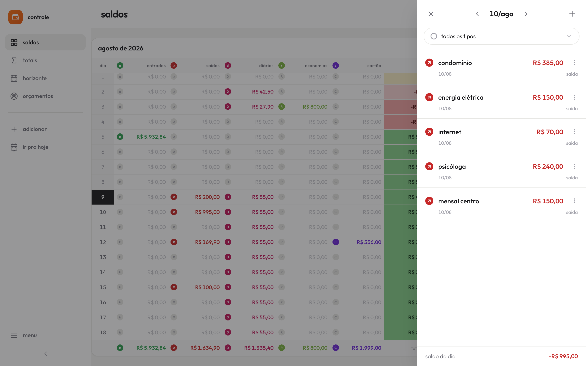

Painel lateral (gaveta no celular) com tudo do dia. Navegue entre dias com as setas — ou com ← e → no teclado —, filtre por tipo e use o menu de três pontos para editar ou excluir. O rodapé mostra o saldo do próprio dia.

### No celular

<p align="left">
  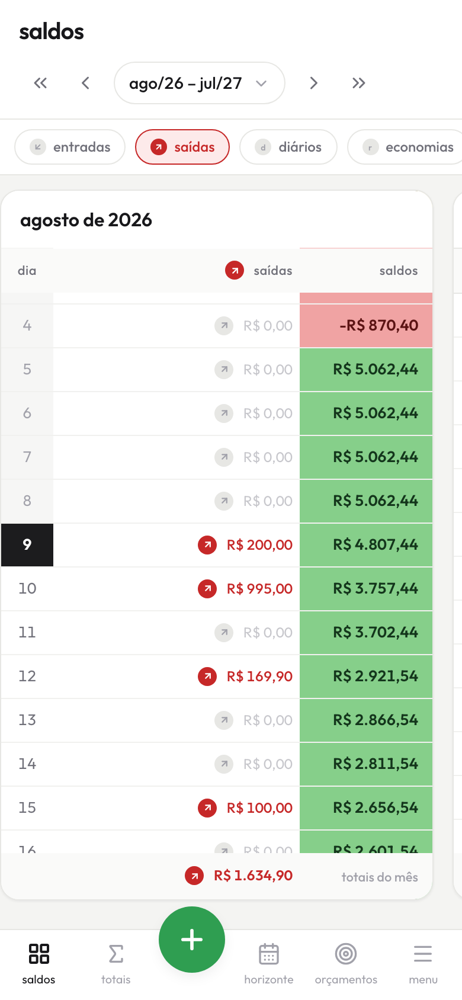
  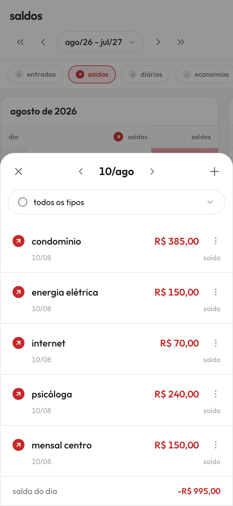
  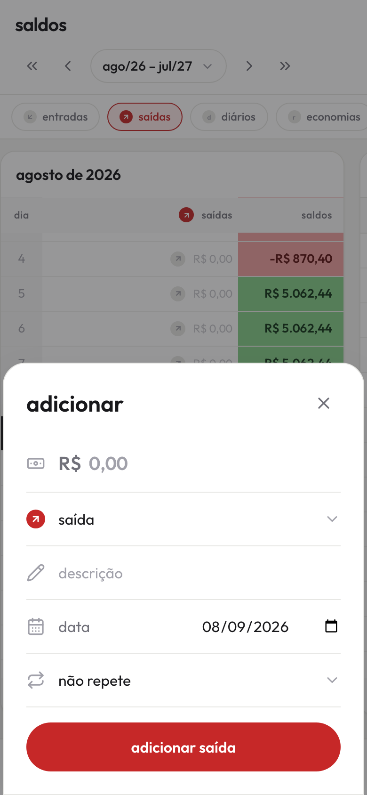
</p>

As cinco colunas de valor não cabem numa tela de celular, então você escolhe qual quer ver nos chips do topo — o saldo continua sempre visível. A navegação vira uma barra inferior com o botão de adicionar no centro.

### Tema claro e escuro

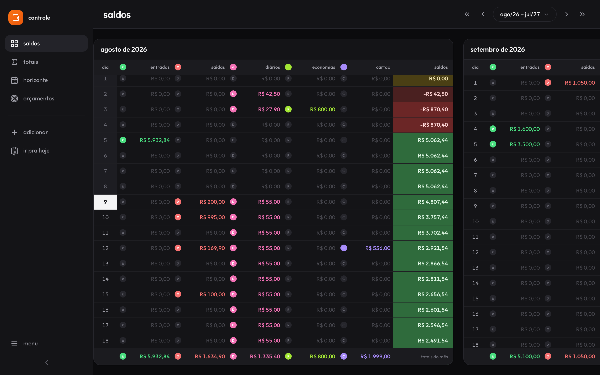

O app segue o tema do sistema e pode ser trocado no **menu** (canto inferior da barra lateral). A escolha fica salva no navegador.

### Atalhos

| Onde | Ação |
|---|---|
| Barra lateral → **ir pra hoje** | Volta a tabela para o mês atual e centraliza o dia de hoje |
| Cabeçalho → `«` `‹` `›` `»` | Navega 1 ano / 1 mês para trás e para frente |
| Cabeçalho → botão do período | Abre a grade de meses para pular direto para um mês |
| Painel do dia | `←` `→` trocam de dia, `Esc` fecha |

---

## 👨‍💻 Guia do Desenvolvedor

### 🛠 Stack

- **Framework**: [Next.js 16](https://nextjs.org/) (App Router, Turbopack)
- **Linguagem**: TypeScript
- **Banco**: PostgreSQL ([Neon](https://neon.tech/)) via [Prisma 7](https://www.prisma.io/)
- **Autenticação**: [NextAuth.js](https://next-auth.js.org/) com Google OAuth
- **Estilo**: [Tailwind CSS 4](https://tailwindcss.com/) sobre tokens em CSS variables
- **Ícones**: [Lucide](https://lucide.dev/) · **Fonte**: [Outfit](https://fonts.google.com/specimen/Outfit)

### 📁 Estrutura

```
src/
├─ app/
│  ├─ page.tsx              landing (visitante) ou app (autenticado)
│  ├─ entrar/               tela de login
│  ├─ layout.tsx            fonte, metadata e script anti-flash do tema
│  ├─ globals.css           tokens de design (claro/escuro) e animações
│  └─ api/                  rotas de transactions, budgets e cards
├─ components/
│  ├─ FinanceApp.tsx        orquestra estado, telas e modais
│  ├─ views/                saldos, horizonte, totais, orçamentos e cartões
│  ├─ shell/AppShell.tsx    sidebar (desktop) e barra inferior (mobile)
│  ├─ landing/              página de apresentação
│  └─ ui/                   Modal, Select, ConfirmDialog, Toast, TypeBadge, ViewHeader
├─ hooks/
│  ├─ useFinanceData.ts     fetch e mutações da API
│  └─ useMediaQuery.ts      breakpoint em JS (via useSyncExternalStore)
└─ lib/
   ├─ ledger.ts             ⭐ o motor de cálculo
   ├─ format.ts             moeda, datas, percentual e faixas do heatmap
   └─ types.ts              tipos de lançamento e seus metadados
```

### ⭐ O motor de cálculo

Todo saldo exibido vem de `buildLedger()` em [`src/lib/ledger.ts`](src/lib/ledger.ts) — uma função pura que percorre dia a dia e acumula o saldo. **Não recalcule saldo dentro de componente**: saldos e horizonte precisam concordar entre si.

Duas regras que precisam ser preservadas:

1. A simulação **sempre parte do mês mais antigo** entre a primeira transação, hoje e o início da janela pedida. Como o saldo é acumulado desde zero, começar depois disso dá um saldo inicial errado.
2. A cota diária dos orçamentos só é descontada **de hoje em diante** (`drain = 0` no passado), onde valem os lançamentos reais.
3. Cada lançamento é somado na sua **data de cobrança** (`chargeDateOf()`), que só difere da data do lançamento no cartão: lá vale o vencimento da fatura. Quem lista lançamentos de um dia precisa usar a mesma regra, senão a lista não bate com a coluna.

Sobre o motor existem três derivações: `summarizeMonth()` (métricas do mês), `summarizeYear()` (economias por mês do ano) e `dailyDrain()` (cota diária).

### 🎨 Design system

Cores, superfícies e sombras são CSS variables definidas em [`globals.css`](src/app/globals.css) e expostas como utilitários do Tailwind (`bg-surface`, `text-fg-muted`, `border-border-base`, …). O tema escuro é a classe `.dark` no `<html>`, aplicada antes da primeira pintura por um script inline no layout — sem isso há um flash branco a cada carregamento.

Ao criar uma tela nova: use os tokens em vez de cores literais do Tailwind, títulos em caixa baixa, e a classe `.tabular` em qualquer valor monetário para as colunas alinharem.

### ⚙️ Rodando localmente

```bash
git clone git@github.com:Afrontoso/controle-financeiro.git
cd controle-financeiro
npm install
```

Crie um `.env` a partir do [`.env.example`](.env.example):

```env
DATABASE_URL="postgresql://..."
NEXTAUTH_SECRET="..."            # openssl rand -base64 32
NEXTAUTH_URL="http://localhost:3000"
GOOGLE_CLIENT_ID="..."           # console.cloud.google.com > Credenciais
GOOGLE_CLIENT_SECRET="..."
```

```bash
npx prisma migrate dev    # cria o schema
npm run dev               # http://localhost:3000
```

Verificações antes de abrir PR:

```bash
npx tsc --noEmit
npx eslint src
npm run build
```

---

## 📝 Licença

Desenvolvido por **Victor Assis**. Achou um bug ou tem uma ideia? [Abra uma issue](https://github.com/Afrontoso/controle-financeiro/issues) ou mande um e-mail.
